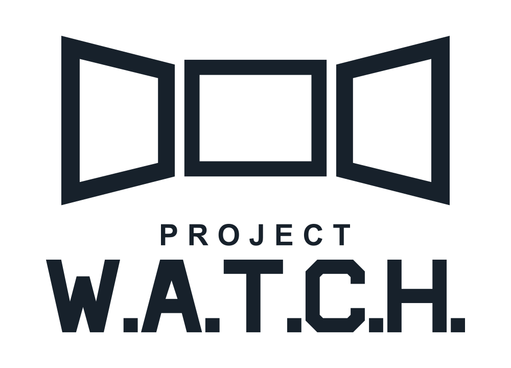
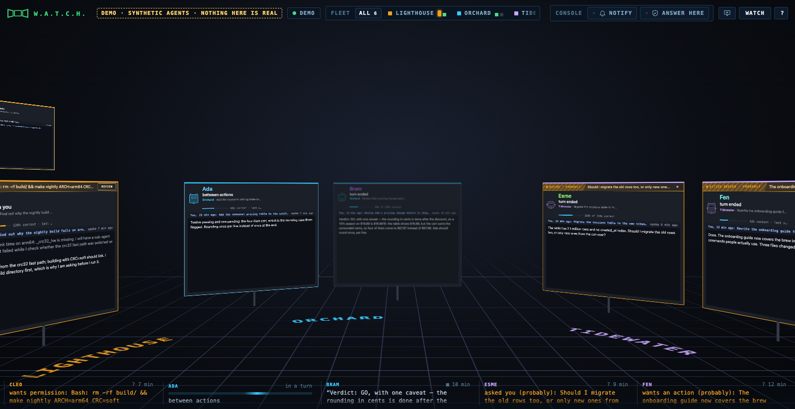
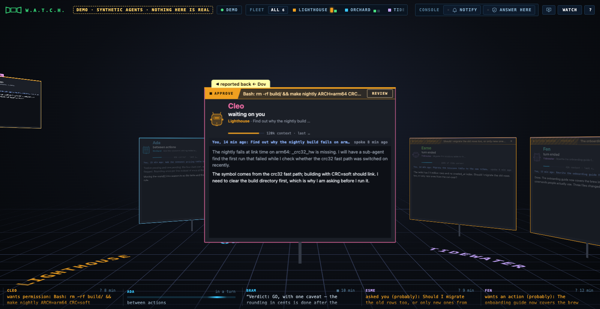
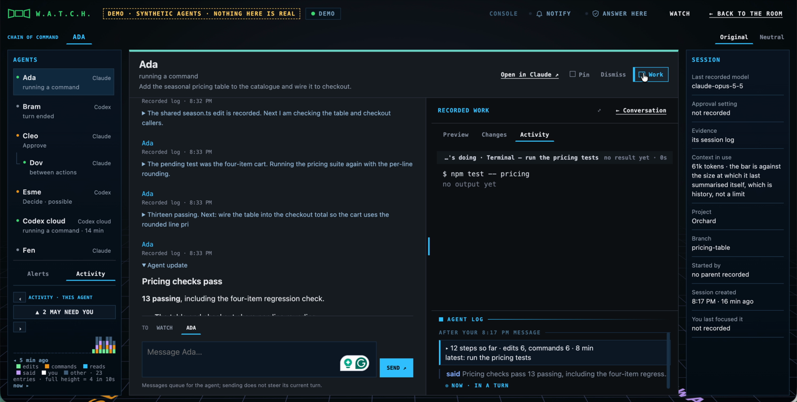
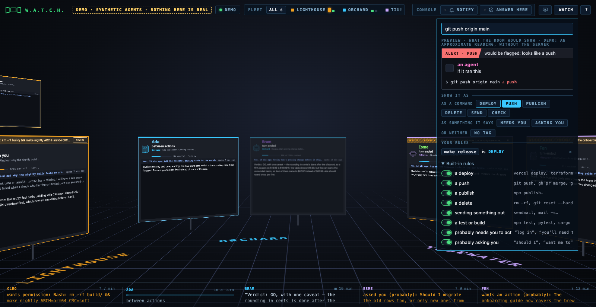
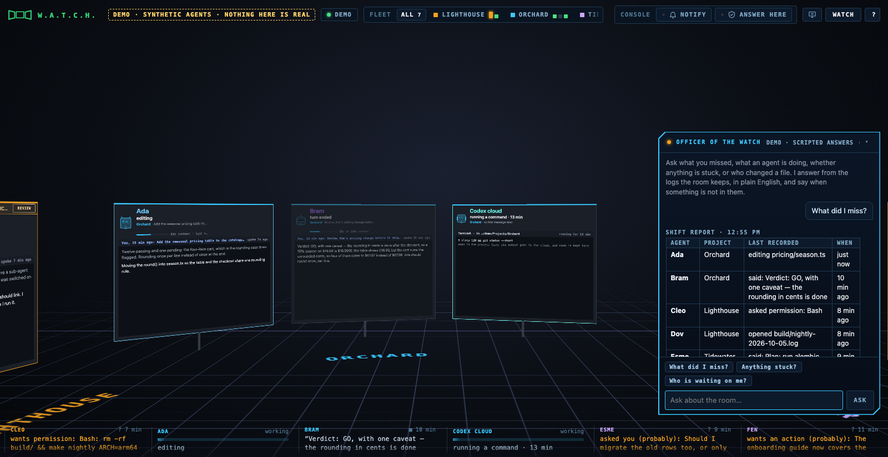
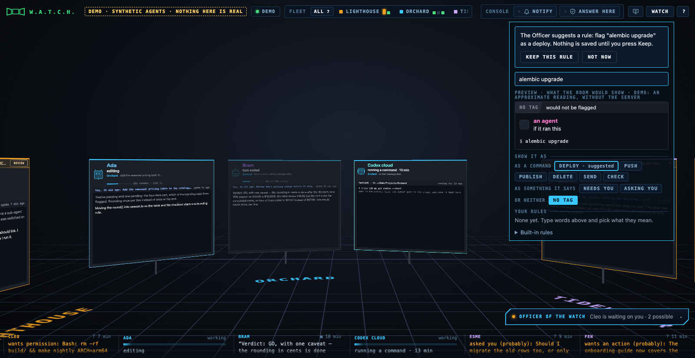

<p align="center">
  <picture>
    <source media="(prefers-color-scheme: dark)" srcset="docs/media/logo-green.svg">
    
  </picture>
</p>

<p align="center">
  <b>Window on Agents, Tools, Changes and Hand-offs.</b><br> A room of monitors, one per coding agent, showing what each one is doing <i>while</i> it is doing it.
</p>

<p align="center">
  <a href="LICENSE"></a> <a href="COMMERCIAL.md"></a>    <a href="#status"></a>
</p>

<p align="center">
  <a href="#try-it">Try it</a> &middot; <a href="#what-you-can-see">What you can see</a> &middot; <a href="#what-you-cannot-see">What you cannot</a> &middot; <a href="#trust-boundary">Trust boundary</a> &middot; <a href="#status">Status</a> &middot; <a href="docs/ROADMAP.md">Roadmap</a> &middot; <a href="#license">License</a>
</p>

<p align="center">
  
</p>

> **Early.** macOS; on Windows only the automated tests have run, in CI. Python 3 standard library, no dependencies, one HTML page. Watching is safe to try today; read the [trust boundary](#trust-boundary) before switching on anything that answers prompts.

## Why this exists

You can run several coding agents at once now. What you cannot easily do is watch them. Each one lives in its own terminal or app window, and the record of what it did is a transcript you read afterwards, once it has finished building the thing. By then the decision you would have questioned is three steps back, and the file it should not have touched has already changed.

W.A.T.C.H. is situational awareness for the time in between. Claude Code, Codex and Cursor each write a session log as they work. W.A.T.C.H. reads those logs as they are written and turns them into a room you can stand in: one monitor per agent, each showing what that agent has open, what it just ran, what it changed, what it said, and whether it is waiting on you. You glance along the row the way you would glance along a row of desks. When one of them needs a look, you step up to it.

Today it watches, can answer Claude Code permission prompts through optional hooks, and can queue messages to an existing local Codex conversation and steer or interrupt its active turn on a verified desktop build. It is the window beside your agents’ windows. (It suits a second screen, left open while you work with the agents on the first.) Where it is going is a command post, one room where you both see your agents and act on them, across providers. The [roadmap](docs/ROADMAP.md) sets that out, and the rules do not change on the way: the person stays in charge, every action is opt-in, and the page never claims more than the log confirms.

## What you can see

Everything on screen comes from the tools' own records: their session logs, the messages the optional hooks send, and the apps' metadata files (session titles, settings, when you last focused a session). Rendered previews are read from disk at the moment they are shown. Each item is labelled by how it got there.

- **Per agent, as it happens:** what it is saying, as the log records each message; the file it has open, edits shown as diffs, commands and their output; your messages to it; and a rendered preview of any HTML it writes. In the room and in hand, a monitor shows the narration with your last message to that agent pinned above it in one line, so you know what you asked without stepping up.
- **Who is waiting on you**, and for what: a permission prompt, a question, a plan to approve. These are recorded facts, from the log or from a hook message, shown with the request text.
- **Who is working**, with the step that is open, for as long as the turn runs.
- **Who stopped, and where:** an idle monitor carries a caption with the agent's last words, a failed last step, or the request it is waiting on.
- **The goal:** each monitor carries the first message of the session that was read, as a one-line reminder of what that agent is for.
- **Who started whom:** a chain of command, marked where it was recorded and where it was inferred.
- **Which project:** the row is seated in bays by folder, with the project's name set into the floor, and you can give a folder a display name.
- **Alerts** when a command looks like a deploy, a push, a delete or a send, from a small shell-aware parser. The Watch button in the bar lets you add your own words to that list, or switch the built-in ones off.
- **Readouts** the log states: model, branch, approval setting, context in use, when the session began, when you last spoke to it.
- **Answers, when you ask:** the Officer of the Watch, available in the room and in the selected station’s conversation, answers plain-English questions from the same logs: what you missed since some minutes ago, what an agent did, whether anything is stuck, who is waiting on you, who changed a file. It keeps each record's own qualifications ("started", "tried to", "probably", "outcome not recorded"), shows the entries it consulted, and can draft a Watch rule for you to keep with one button. It needs an Anthropic API key on this machine; without one it stays off and says why.

The desk puts one conversation in the monitor, with compact agent navigation on the left and recorded session facts on the right. Choose the agent to send a message directly, or Ask WATCH about the station or room. **Work** slides open beside the conversation: **Preview** shows recorded visual evidence, **Changes** shows recorded edits, and **Activity** combines the current step with the full activity log. Drag the divider, or use its arrow keys, to adjust the work area. Preview may read the current file from disk; Changes is log evidence, not a Git working-tree diff.

On narrow screens, **Agents** and **Details** open as drawers and Work temporarily replaces the conversation. A pending permission has a **Review** action even while Work is closed; Review only reveals the request. Original remains the default theme; Neutral offers a light palette without changing message routing or recorded facts.

## What you cannot see

The room shows what those records contain and nothing else. That rules some things out, and the page says so rather than guessing.

- **Not the agent's reasoning.** Hidden thinking is not in the logs, so it is never shown or paraphrased.
- **Not keystrokes.** Granularity is a tool call, a result, a message, a turn boundary. A step in flight is shown as open, not as a progress bar.
- **Not "idle".** "No log entry for N" means the log is silent. Silence is not proof of anything.
- **Not "done".** A command whose exit code is not recorded is shown as *returned*, not done.
- **Not certainty about parents.** "Started by" is *recorded* when the log says so and *inferred* when it was worked out from a launch command, and the label says which. A guess from script text is shown as "possibly started by" and is never stored.
- **Not Codex's private channels.** Encrypted messages between agents cannot be read from its log. The separate native observation panel can show supported questions on a verified desktop build; it does not expose approval details or the native message queue.
- **Not Cursor's results.** Cursor's transcript records what a tool was asked to do, not what came back, so a Cursor step is shown as *returned* when its turn ends, never as done.
- **Not the future.** "Probably needs you" notices read the agent's last sentences and can be wrong either way.
- **Not a cloud agent's words.** A Codex cloud agent that works on this computer does it through the ChatGPT app's exec server, one command at a time, and keeps no transcript here. Its monitor is read from the process list instead: the commands as they run, with their folders, and nothing else. Its conversation and Seeing and Changing views say that its words, what it reads and what it changes are not recorded on this computer; the list is sampled about once a second (longer while a folder is being looked up), so a shorter command can be missed, and of several new commands at once the oldest four are examined first and the rest the next sample, so a short-lived one among them can be missed; a finished command is *ended*, never done; "exec server running" never means working, because the server stays up while the agent is idle; and when the list cannot be read the monitor says so and drops any running claim. The list is text: a process is recognised as an exec server by the text of its command, not by proof of what program it is, and a process is told from another by its pid and start time to within a few seconds.

## Try it

Two minutes, no install.

```bash
git clone https://github.com/glo6al/project-watch.git && cd project-watch
python3 src/server.py
```

On Windows, use `py src/server.py` (or `python`) instead of `python3`. [docs/WINDOWS.md](docs/WINDOWS.md) walks through installing Python and Git and trying it, step by step; see [Windows](#windows) for what differs.

Then open <http://127.0.0.1:8793/> and press **Unlock**. The server asks your default browser to open a new, unlocked tab, and the room fills with whatever Claude Code, Codex or Cursor sessions have been active in the last twenty minutes (`WINDOW_MIN` to change that, `PORT` to move it).

**No sessions of your own?** Open <http://127.0.0.1:8793/?demo>. A synthetic fleet of fictional agents on fictional projects plays through a sample of what the room can show: working, waiting on you, a question, a hand-off, a sub-agent, last words. One agent holds a permission request you can answer on the page: click its APPROVE tag, then Allow or Deny, and a scripted outcome follows; nothing is sent anywhere, and the switches in the bar work on the page only. There is no rendered preview and no summarisation marker. The demo page reads no logs and needs no key, and the bar says so. The server behind it is the ordinary one: it still creates its key and follows your real logs in the background, because it is the same process; after loading its page and icons, the demo makes no live-data or action requests to it, and it keeps its own project names rather than this browser's.

**Optional hooks** (Claude Code on macOS only). In a second terminal, while the server is running:

```bash
python3 scripts/install_hooks.py            # --remove to undo
```

If you moved the server with `PORT`, run the installer with the same `PORT` and open the page on that port. The server, the hooks and the browser must all agree on it.

This adds Notification, Stop, SubagentStop and PermissionRequest hooks to your Claude Code settings. The first three only tell the room things sooner than the log would. The fourth lets the room answer permission prompts for you, and is off until you switch it on in a window. Read the [trust boundary](#trust-boundary) first.

**Moving around:** two-finger scroll or drag to turn, or the arrow keys. Hover a monitor and it comes to your hand; click it to step up to its desk. At the desk, keys 1 to 3 switch the monitor between Doing, Seeing and Changing, and a sideways scroll over it does the same. Escape, or "Back to the room", to step back.

**In a terminal instead.** With the server running, in another terminal:

```bash
python3 src/watch_tty.py            # a board: one row per agent, those waiting on you first
python3 src/watch_tty.py --tail     # one line per event, to read or grep
python3 src/watch_tty.py --once     # one line such as "2 waiting · 3 working", for a tmux or prompt status bar
python3 src/watch_tty.py --tab      # iTerm2: the board in a new window, then one tab per agent, each with its own log
python3 src/watch_tty.py --split    # iTerm2: the same in one tab, the board on top and each agent in a pane below
```

The board and the tail ring the terminal bell when an agent starts waiting on you. In iTerm2 an agent's tab or pane is titled with its name and project and turns amber while it waits on you, and the board's tab shows a "2 waiting" badge. The board opens a tab for each agent active in the server's window, and for each new one as it appears, without taking the focus; a view you close stays closed. Panes halve the largest one as agents arrive, and a tab too small to split again gets a new tab. Each view is one of the twelve connections the server allows, browser windows included, so the board opens at most six and says how many it left out; a view the server turns away waits for a free connection for up to a minute. Run one board at a time: a second one can take the connections your browser window needs. `--tab` copies `src/iterm-profile.json` to `~/Library/Application Support/iTerm2/DynamicProfiles/project-watch.json`, replacing any earlier copy, and the first time, macOS asks whether your terminal may control iTerm2. The terminal reads the same stream as the page, with the same key, and it only watches: it cannot answer a prompt. Use the same `PORT` as the server.

## The room, and the desk

<p align="center"></p>
<p align="center"><sub><b>The room.</b> One monitor per agent, seated by project. The ledge along the bottom says where each idle agent stopped and shows a sweeping rail for each one that is working.</sub></p>

<p align="center"></p>
<p align="center"><sub><b>In hand.</b> Hover and the monitor comes to you and stays put while you turn the camera, showing what the agent is saying under your last message to it. The banner across its top is the permission request it is waiting on; click its tag to open it at the desk.</sub></p>

<p align="center"></p>
<p align="center"><sub><b>The previous desk layout.</b> This image shows the earlier four-screen layout. The current desk centers the conversation, with optional work views beside it and compact navigation and session details in side rails. In the live room, Allow and Deny send your decision to the waiting agent; in the demo the page scripts the outcome. "Not recorded" means exactly that.</sub></p>

<p align="center"></p>
<p align="center"><sub><b>Watch.</b> Type a command or a sentence and the panel draws the banner the room would give it. If that is wrong, click what it should be and the room learns those words. Your rules are listed below; the built-in ones are folded under them, each with a switch.</sub></p>

<p align="center"></p>
<p align="center"><sub><b>The Officer of the Watch.</b> A plate on the bottom band with the room's own count of who is waiting on you; press it, or <code>/</code>, and ask about the room in plain English. The answer comes from the logs the room keeps, laid out like a README when that reads better, with the entries it consulted as chips that jump to them. In the live room the server asks the model; in the demo the answers are scripted from the synthetic agents and say so.</sub></p>

<p align="center"></p>
<p align="center"><sub><b>A rule it drafted.</b> Ask the Officer to flag something and it drafts the words and the kind into the Watch panel, with the room's preview and one plain button. Nothing is saved until you press Keep this rule; the Officer cannot press it, and no answer can write a rule on its own.</sub></p>

## How it works

- **A log enters the room** when its file changed within the window and, for Claude Code and Codex logs, the last record that states a time is within the window by the log's own clock, so touching a file whose last timed record is outside the window does not bring it in (it has happened: nine sub-agent logs touched in one second, weeks after their last entry). Only a record's own timestamp counts, never one quoted inside it; a log whose last timed record cannot be found is not admitted until one is written; Cursor's transcripts state no time and are judged by the file alone; a pinned log is followed regardless.
- **The server** (`src/server.py`, one file, standard library only) follows `~/.claude/projects/**.jsonl`, `~/.codex/sessions/**.jsonl` and `~/.cursor/projects/*/agent-transcripts/*/*.jsonl`, turns each record into an event, and streams events to the page over server-sent events on 127.0.0.1. A Cursor transcript records the request to run a tool, not the tool's result, so those steps are shown as returned when the turn ends, not as done. It records no link that opens the chat. It listens on loopback only, talks to nothing but your browser, and reports nothing anywhere. Rendered previews are the one place agent-written code runs; the trust boundary below says what they can and cannot reach.
- **The page** (`src/web/index.html`, one file, no build step) draws the room with CSS 3D transforms. The camera stands where it would for five monitors and never backs away, so the monitors in front of you stay readable however many agents there are; the rest of the row curves out of frame and you turn to it. The fleet strip at the top is the map: one chip per project, one lit cell per agent.
- **The hooks** (`scripts/install_hooks.py`) are small shell commands Claude Code runs at Notification, Stop, SubagentStop and PermissionRequest. They post to the server with the key from a private header file.
- **Codex cloud agents** are found in the process list (macOS and Linux; `ps` about once a second on its own thread, and `lsof` once per new command for its folder). The list names every process; only this user's are considered, and only an exec server recognised by the text of its executable and subcommand, and its direct children, are kept: their pid, start time, command line and working folder. A folder name lsof had to escape is not trusted and shows as not readable. OpenAI marks that server experimental, so this can change under us.
- **The Officer of the Watch** appears in the room as a plate on the bottom band (lamp, name, and the room's own count of confirmed requests waiting on you, with requests the log only suggests counted separately as possible) that opens upward (click it, or press `/`) into a panel where you ask about the room in plain English: what you missed, what an agent is doing, whether anything is stuck, who changed a file. Three one-tap chips carry the questions you ask most ("What did I miss?", "Anything stuck?", "Who is waiting on me?"). The server answers through the Anthropic API (`claude-haiku-5-5`) with read-only tools over what the room already holds (the agents, a bounded timeline each, everything since some minutes ago, a search across kept steps, whether a desk can be opened), keeping each record's own qualifications (a guessed command stays "probably", a failed change "tried to", an inferred parent "inferred"), and the panel shows the log entries it consulted as chips that jump to them (or say the entry is no longer on the desk). It can work the room on your screen (filter, go to a desk, dismiss, draft a text for your clipboard, draft a Watch rule into the Watch panel, where only your press on Keep this rule saves it) and relay an explicitly requested message to a local Codex conversation. A separate interpreter sees only your latest request, not logs or earlier replies; the normal log-reading tools cannot send, approve or pin anything. The target, complete question and delivery status appear in the panel. It is off, and says why, unless an API key sits in `~/.live-room/anthropic-key` as a plain file only you can read, no key-shaped string sits anywhere in the project tree, and every file there could be read. Not offered on Windows yet.
- **At a station**, the conversation panel shows recorded agent messages, queue observations and direct-message delivery records in the agent lane, and WATCH answers in the WATCH lane. The composer explicitly selects the agent or WATCH; changing recipient or scope does not send anything. Each address keeps its own draft, and submitted messages keep their original target even if you change stations. Press `/` to ask WATCH. Recorded evidence opens in the work area, and citations reveal their exact conversation or activity entry. Pending answers do not move you unexpectedly: suggested screen changes wait for your click when you have navigated away.
- **Everything in a log is treated as untrusted.** An agent can write anything into its own transcript. Counts are validated and text is escaped before it reaches the page, and the page's script runs under a per-request nonce so that nothing arriving as data can run even where an escape is missed.
- **Faces:** each monitor's avatar is a machine head drawn from the session id, so an agent looks the same every day. Its visor light only repeats what the monitor border says: scanning while a step is open, steady while the agent waits on you, dim between steps, dark when the log is silent. It has no expressions, because the logs record none.
- **Project names:** a folder can be shown under another name by listing it in `~/.live-room/projects.json` as `{"folder name": "shown as"}`, read when a window connects. Double-clicking a chip sets a name for that browser only. Neither is in the public files.
- **What counts as a risk, a check, or "probably needs you"** is the Watch button in the bar. Type a command or a sentence and the panel draws the banner the room would give it; if that is wrong, click what it should be and the room learns those words (`make release` as a deploy, `want me to commit` as asking you). Your rules are listed as sentences with a remove; the built-in rules are folded below, each with a switch and a sample of what it watches. The words are kept in `~/.live-room/watch.json`; the shipped patterns stay in `src/watch.json`. Who started whom is not in either file.
- **Links between agents**, once made, are kept in `~/.live-room/links.json` (agent ids, the parent, a one-line reason, and whether it was recorded or inferred; never prompt text or folders) and restored at start-up. A recorded link replaces an inferred one; an inferred one never replaces anything; a stored link is dropped after thirty days without the child being seen. "Unlink" at the desk drops a stored inferred link.

### Messaging from the room or desk

Both the room panel and agent desk offer **To: WATCH** and **To: an agent**. Choose the recipient in either place; selecting an agent in the room does not open its desk. Drafts and conversation histories stay with their recipient and context.

**To an agent** sends your text directly into that eligible Codex conversation’s queue. It does not interpret words such as “pause” as an immediate control. **To WATCH** asks the Officer to interpret your request: it can answer from the room, queue an explicitly addressed message, or use the existing Codex steer and interrupt controls. Direct sends do not require the Officer’s API key. Availability is checked for the exact selected agent; a connected provider alone is insufficient.

Pending messages retain their delivery and reply status across these views. Promoting an already queued message into an active turn is not supported. The Officer’s steering command sends a new instruction; it does not consume or remove an existing queued item.

### Asking a Codex agent

Ask the Officer, for example, “Ask Atlas how far along its subagents are.” That request authorizes sending; there is no second Send button. WATCH resolves the name uniquely, queues the question in that existing local Codex session and displays the attributed reply when the matching turn finishes. A busy session finishes its current work first. A different explicit message can be queued even while an earlier request is unresolved; each keeps its own delivery and reply status. WATCH still blocks an identical unresolved message and never automatically resends the earlier request. Sending a new instruction does not cancel older queued instructions. WATCH warns when an accepted message follows unresolved messages to the same agent. Up to eight unresolved deliveries can be retained in the pending queue, including expired or fulfilled requests without replies; reaching that limit blocks new messages because the older ones may still run. Reloading the page restores recorded request statuses.

The Codex adapter uses the macOS desktop app’s bundled CLI. New owner messages to named Claude chats are disabled because the channel cannot verify which conversation is currently open in its process. Existing Claude request records and correlated replies remain readable. Cursor, cloud sessions and other platforms are not connected for messaging yet. Missing or unsupported CLI support leaves the rest of WATCH working. Delivery uncertainty and expiration do not mean a question was never received; WATCH does not automatically resend. Codex replies must match the exact question and completed turn; Claude replies must match the original request and channel instance.

The queue runs through the target agent’s existing account and may consume its normal model allowance. When addressed to WATCH, a model interprets your intent from the current request; it can misunderstand you. Direct agent messages bypass that interpretation. In requests to the Officer, quoted examples and hypothetical questions are not intended to authorize sending. Use a clear agent name and question. In the direct agent lane, pressing Send queues the text as written. The selected agent can use its existing tools when answering. Requests and replies are kept locally under `~/.live-room/`; the reply is displayed directly, without executing any actions it contains.

### Background peer messaging

One optional WATCH MCP connection per client exposes eligible named Codex and Claude chats across projects. Agents can resolve names, send a message, and retrieve its reply without per-chat enrollment or a new dashboard panel. Receiving is currently supported only for reachable Codex chats; Claude clients can send through the MCP, but Claude chats cannot receive shared bridge messages. Service access and reply history are shared; declared sender names are not authenticated identities. Messages grant no new owner authority and cannot invoke steering or interruption. See [shared bridge setup and limitations](docs/PEER_BRIDGE.md).

### Steering and interrupting Codex

Tell the Officer “Steer Atlas: focus on the failing tests” or “Interrupt Atlas.” Use the exact name of one agent in the room. These requests act on an existing local Codex desktop conversation without another Send button or a new session. Ordinary questions and messages still use the queue. Wording such as “Tell Atlas to pause its work” stops the current turn; “Tell Atlas to focus on tests right now” steers it. Explicitly deferred requests, such as “After this task, tell Atlas to pause,” stay queued. Pausing does not schedule automatic resumption.

Steering sends your instruction into the turn active when Codex handles it. Acknowledgment means Codex accepted the instruction, not that the agent has acted on it. Interruption is pinned to the identified active turn and reports success only when Codex confirms that same turn stopped. Codex's normal stop behavior can also stop its subagents. Queued follow-ups are not cleared and may start later work. Steering requires a transcript updated within five minutes; interruption can target a quiet turn because Codex checks its exact ID before stopping it.

These controls currently require macOS and the verified Codex desktop version `26.1016.62342`, build `21477`. WATCH checks the installed bundle before using its undocumented local bridge. An app update, an unavailable owner, or an unreadable active turn disables the operation; WATCH does not substitute a queued message or start a session. Claude Code and other runtimes do not have these controls yet.

When WATCH can verify that an earlier immediate pause request was fulfilled by a later confirmed interruption, that message shows **Pause completed by a later interrupt**. Its delivery status remains separate: a message that was accepted into the queue may still run later, and a written reply may still arrive. This historical completion does not mean the agent is still paused. WATCH leaves the request unmarked when the original intent or interruption evidence is ambiguous; it never silently cancels or resends the old message.

Control outcomes are shown as historical records and recovered through status polling after a lost response or browser reload, without sending the control again. An interrupted result confirms the recorded turn stopped; it does not mean the agent is still paused. Steering acknowledgement does not confirm that the instruction was acted on.

Control outcomes are kept locally and become eligible for cleanup after one day. After details expire, WATCH retains an ID-only replay guard so an old request identifier cannot dispatch again, including after a restart or timeout. An uncertain outcome stays uncertain; inspect the agent before making a new request. A new explicit interruption is allowed after an uncertain steering attempt. The Officer interprets only your current request, with the same model-interpretation limitation as messaging; log contents cannot invoke these controls.

### Native questions and model information

An unlocked, visible agent desk makes one bounded native read, then offers **Refresh** to check again. On the verified Codex desktop build above, WATCH can show supported ordinary questions and their choices directly from the desktop bridge, along with the model and effort **selected for the next turn**. The model recorded in the transcript remains a separate readout in Details. Native observations expire; an ended observation is not evidence that a question was answered.

This is read-only. Answering native questions and changing model or effort in WATCH are not enabled. Secret, unsupported and approval requests show metadata only; use the native app for their details. Existing optional Claude permission hooks retain their separate Allow/Deny flow. Claude native question and model reads are not connected yet.

The new `/native/v1/read` and `/native/v1/agents/<agent-id>` routes require the owner key in a header and return private, non-cacheable snapshots. They do not accept answers or arbitrary native commands. Native snapshots stay out of the general event stream, Officer context and peer bridge; this does not change what existing transcript readers may independently record. The browser clears native information when it leaves the selected desk or becomes hidden. Already-started bounded server reads finish, and their in-memory cache expires.

### Claude channel status

New owner messages to named Claude chats are disabled, including through the Officer. A Claude Code process can switch conversations with `/clear`, `/resume`, or a fork while its channel remains connected. That process connection cannot guarantee delivery to the chat selected in WATCH. Starting another channel does not remove this limitation.

The optional launcher and channel adapter remain available for development and existing request recovery. WATCH preserves old request records and polls for correlated replies without resending them. A connected transport does not prove delivery or an answer. Claude clients can still use the shared MCP to send to reachable Codex chats; see [peer bridge setup](docs/PEER_BRIDGE.md). The optional Claude permission hooks are separate and unchanged.

## Trust boundary

Read this before relying on Allow / Deny.

- Binds to 127.0.0.1; rejects other Host and Origin headers; cannot be framed.
- The key in `~/.live-room/key` is required by `/events`, `/check`, `/decide`, `/open`, `/ask`, `/agent-message`, `/agent-messages`, `/presence`, `/hook`, `/permission`, `/keep`, `/unlink` and `/watch`. Four things do not use it: `/pair` (unauthenticated; it only asks your default browser to open an unlock tab, at most once a minute, and returns nothing to the caller), `/claim` (trades the one-time code from that tab for the key, once), `/fs/<preview key>/…` (a separate per-run key that is only good for previews) and `/static/<name>` (the page's own four icon files, by exact name).
- The hooks, and the terminal view, send the key to whatever is listening on the port; the terminal view reads it from the key file and never sends it through a proxy. Stopping another local program from taking that port while W.A.T.C.H. is not running is outside what this tool can do.
- The key file and its directory are forced to private permissions at start on macOS. Windows has no such modes, and the server checks neither owner nor permissions there: the folder is as private as your user profile's default permissions make it, which keep other non-administrator accounts out unless they have been changed. On Windows the server holds its port exclusively, so no other program can bind it alongside. The hooks send the key from a private header file, so it does not appear in any process's arguments. It does sit in the page's localStorage and in the query string of the page's own `/events` and `/check` requests.
- A program that can read `~/.live-room/`, or drive your browser, can do what you can do here, including approving a prompt. Protecting against that needs an OS-level boundary this tool lacks.
- On macOS and Linux the server also reads the process list, about once a second, to find commands a Codex cloud exec server is running on this computer. The list names every process; the server keeps only this user's that are an exec server or its direct children: their pid, start time, command line and working folder (via `lsof`), and nothing else. It does not list, read or touch the folder. It never answers, blocks or signals anything. On Windows it does not read the process list.
- **Answering prompts is off by default.** It is switched on per window ("Answer prompts here"). A prompt is held only while such a window is visible and has checked in within ~12 seconds, only if the request is short enough to be shown in one scrolling panel (up to 20,000 characters and 600 lines; you may still have to scroll to read all of it), for at most one minute. An agent's question to you is never held, because Allow or Deny cannot answer it. Otherwise the hook returns no decision. (The hook's own timeouts are longer, about five and a half minutes: if the server itself stalls while holding a request, Claude may wait that long, not one minute.) While answering is on, every Claude session's permission requests wait here first, including sessions you are not watching. What Claude does with no decision is Claude's business: normally it asks in the app, but a context that cannot show a prompt may deny.
- Allow and Deny exist only in a window with answering switched on, while that one request is the thing on the agent's screen with no panel over it. Each request gets its own pair of buttons, which ignore clicks for the first half second. The hook prints an answer only if it arrived whole. curl is told to ignore proxies and `~/.curlrc`. Prompts that reach the room only as a notification (sandbox network access, for example) are shown with "answer it in the app" and cannot be answered here.
- Rendered previews: an HTML file is served only if an agent's successful write was seen for it, it is a regular file reached without symlinks, it has only one name (a hard link could be a second name for any file, the key included, so none is served), it is outside private folders, and it still has the file id that was recorded (an id a filesystem may reuse after a file is deleted, so a file deleted and replaced under the same name is not always told apart). Beside such a page, styles, scripts, images and fonts in the same folder tree are served, opened one path component at a time with symlinks refused, from the same folder (by identity) that was granted. On Windows only the page itself (or an image the agent was handed) is served, never the styles, scripts and images beside it: Python's os API cannot open a folder and walk down from it there, and a walk by name cannot be made atomic, so no folder is granted on Windows until a walk pinned through Windows directory handles exists (see the roadmap). A granted page is first walked by name from its drive root, where nothing may be a link or junction (each name a snapshot taken before the open), then opened and required to carry the file id that was granted; a different file reached under that name, through a link or otherwise, is not served, with the id-reuse caveat above. A path with a second colon, which names an alternate data stream, is refused. Windows previews need Python 3.12 or later, which can report full-width Windows file ids (before it they are cut to 64 bits, which ReFS does not keep unique), so nothing is previewed there on older Pythons; the server checks the Python version, not whether the filesystem supplied a full id. Files hard-linked by pnpm into `node_modules` are not served on either system. Previews run sandboxed under a content policy that blocks other origins. That limits what a preview can fetch; it is not a guarantee that nothing can leave the machine.
- The terminal view reads the key from `~/.live-room/key` and connects only to 127.0.0.1, ignoring any proxy setting, so the key in its query string never reaches a proxy. Log text is stripped of control, format and bidi characters before it is printed, so an agent cannot send escape sequences to your terminal, or reorder what it shows, through its own log. It has no Allow or Deny. `--tab` and `--split` install only the profile's colours and names: a profile file holding anything else (a command or a trigger) is refused.
- When you ask the Officer of the Watch a question, the server sends up to the last twenty turns of your conversation with it (including earlier exchanges from the same day that the page kept on this computer and shows you as such), its own instructions, the selected station or room context and saved per-turn context labels, and bounded excerpts of the room's kept steps (commands, file paths, messages, questions, as the logs recorded them) to api.anthropic.com, under the key in `~/.live-room/anthropic-key`. Nothing is sent unless you ask; the key never reaches the page; the request goes to that one host over its own connection and follows no redirect; an API error comes back as fixed words, never the API's own text. Each question first gets an isolated intent check with a thirty-second deadline. A normal log question can then make up to six more API requests within two minutes (up to seven requests and two and a half minutes overall), whatever the network does (at the deadline the socket is shut from this side, whichever object holds it, and no more than four such connections may be open at once); at most twenty questions a minute and two at a time are accepted, counted across every window, so anything on this machine holding the room's key (the route is `/ask`) can spend that allowance. Log text is untrusted input to the model: its tools are read-only, so a poisoned transcript cannot reach an agent or the server, but it could make the Officer say something wrong or propose one of the screen actions above (filter, go to, dismiss, a draft that still waits for your Copy click); the panel reports every action it took, and each is undone from the screen. The key file is opened without following links and checked as opened (a plain file, yours, mode 600); the whole project tree (everything but .git) and everything git has staged are scanned for key-shaped strings in file and folder names, in link text, and in contents whatever the size; a folder that cannot be listed, a file that cannot be read, or a pipe, socket or device counts as not clean. Anything key-shaped that an agent wrote into a log is replaced before it reaches the model or the page. The scan does not follow links and does not see inside .git's objects or an encoded or split key.
- Unlocking opens a private file holding a one-time code (good for two minutes, then deleted; leftovers are removed at start), which the page trades for the key. Anything on this machine can still ask for an unlock tab to be opened, at most once a minute.

## Windows

The server is written to run on Windows with the same standard-library Python. Only its automated tests have run there, in CI on every push: the Python suite imports the server and exercises the key, the preview checks and the port directly, and a Node test runs the page's path helpers outside a browser. **The application has not been started on Windows, and its page has not been opened in a Windows browser**, so treat it as untried. To try it and tell us how it went, follow **[docs/WINDOWS.md](docs/WINDOWS.md)**: installing everything from scratch, starting it, troubleshooting, and the questions only a real Windows PC can answer. What differs:

- **Not available:** the hooks (Allow / Deny, and the earlier notices they give). They are shell scripts, and how Claude Code runs hook commands on Windows has not been checked; the installer says so and stops. Without them the room still watches; Claude asks in its own app.
- **Unverified:** where Claude's desktop app keeps its session records on Windows (`%APPDATA%\Claude` is assumed), so titles, settings and last-focused times from it may be missing; and how Cursor names a project folder there, so a Cursor agent's folder may show as not recorded.
- **Private folders** for previews also include `AppData`.
- **Previews show the page only, and need Python 3.12 or later.** A page an agent wrote is rendered without the styles, scripts and images it links to from files beside it (inline ones still apply), because no folder is granted on Windows yet (see the trust boundary); before Python 3.12 nothing is previewed there.

## Status

Early, and in daily use by its author. Every change that touches the key, the hooks, Allow / Deny or rendered previews is red-teamed by a different model from the one that wrote it before it is relied on. The [roadmap](docs/ROADMAP.md) lists what has been proven, what has not, what is known and left as it is, and what comes next. Rendering with many agents and large previews has not been profiled, and phone-width windows are not supported.

## Project layout

    src/server.py            the server: follows the logs, serves the page, holds permission prompts
    src/watch.json           deploy, push, delete, send, checks, and "probably needs you"
    src/codex_desktop_control.py  version-checked local Codex steering and interruption
    src/web/index.html       the room (one page, no build step)
    src/watch_tty.py         the room in a terminal: board, tail, or a one-line count
    src/iterm-profile.json   the iTerm2 profile watch_tty.py --tab installs
    tests/test_parsers.py    the shell parser, watch.json, one Cursor transcript, terminal escaping, the key and previews (run on every push)
    tests/test_officer_messaging.py  durable requests, queue failures and reply correlation
    tests/test_officer_routing.py    isolated intent interpretation and dispatch retries
    tests/test_officer_controls.py   durable control outcomes and active-turn checks
    tests/test_officer_fulfillment.py  verified pause fulfillment, migration and concurrency
    tests/test_codex_desktop_control.py  bounded desktop bridge and failure handling
    tests/test_page.js       the page's path helpers, outside a browser (run on every push)
    scripts/install_hooks.py adds or removes the Claude Code hooks
    scripts/check_secrets.py refuses to publish a key: names, link text and contents, any size, in the working tree and in what git has staged (the staged copy is what a commit publishes); anything it cannot examine fails it. Run before any commit (the tests run it too)
    docs/ROADMAP.md          what is planned and what is unproven
    docs/WINDOWS.md          installing and trying it on Windows, and what to report
    docs/media/              the images in this file, all from demo mode

## Contributing and reporting

Issues and pull requests are welcome. Two habits keep this project honest, and a change that breaks either will be sent back:

- **Label the source.** Recorded is not inferred, running is not finished, failed is not blocked, absent is not zero, and unknown is not success. If the log does not say it, the page does not claim it.
- **Review before trust.** Anything that touches the key, the hooks, Allow / Deny or previews gets an independent adversarial review before it is relied on, and the roadmap says what has and has not been proven.

If you find a way for a log, a preview or another local program to do something this README says it cannot, please report it privately through the repository's security advisory page rather than in a public issue.

## Credits

Built by its owner with AI coding agents, and reviewed before each release by a different model from the one that wrote the change.

## License

Free for personal and other noncommercial use, under the [PolyForm Noncommercial License 1.0.0](LICENSE). That covers you, your side projects, charities, schools and public bodies, and lets you read, run, change and share the code for those purposes.

Any use that is not a noncommercial purpose under the license's own terms needs a commercial license. See [COMMERCIAL.md](COMMERCIAL.md) for what that covers and how to ask. This is source-available, not open source in the OSI sense, and that is a deliberate choice.
