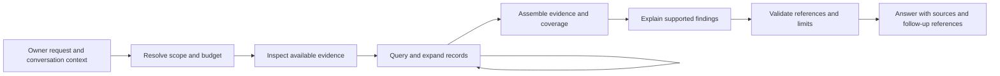

# Officer capability design

Status: implemented locally, independently reviewed and tested. This document does not describe a published release.

The Officer should answer natural questions about recorded work by composing a small set of read capabilities. Questions are acceptance tests, not a fixed menu. The shared design must support narrow lookups, comparisons, quantitative questions, retrospective reports and follow-ups without adding a separate implementation for each wording.

The central requirement is evidence sufficiency: establish the intended scope, gather suitable evidence within a budget, explain what is missing, and keep the answer within what the evidence supports. Retrieving every matching retained record does not prove that capture was complete or that the model interpreted it correctly.

## Existing foundations and gaps

The current Officer already has model-led tool selection, scoped live and historical queries, multiple tool rounds, citations, model routing and API usage accounting. The missing pieces are broader access, connected context, useful reductions and explicit coverage checks.

The baseline for this design is the Officer implementation at `f006ad5`. Relevant components are `src/server.py`, `src/deck_log.py`, `src/officer_instructions.py`, `src/officer_policy.py`, `src/officer_usage.py`, `src/web/index.html` and their tests.

Examples of the current limits:

- Archive chat/project directories and exact-event lookup exist, but are not offered to the Officer.
- The daily digest counts a bounded prefix, then its evidence is reduced again for delivery. Broad live queries can favor busy chats. Live search can return a short prefix that excludes the matching words.
- Operation starts and results have linking identities, but the Officer lacks a direct lifecycle lookup. Historical assignments, relationships and task transitions are often not retained.
- Current model, context and branch observations may exist in WATCH without being exposed through the Officer's tools.
- Follow-ups preserve answer prose but lose the tool evidence. The Officer's conversation history is separate from native-agent history and currently resets daily.
- The answer loop has fixed limits and no explicit check that the requested agents or periods were covered. Usage accounting measures cost; it is not a request budget or an answer-quality check.

## Intended experience

The owner asks normally. The Officer resolves the subject and time period, chooses appropriate read operations, and answers with relevant sources. It asks a clarification only when ambiguity materially changes the answer.

A short answer needs no diagnostic dashboard. A broad answer gives a compact description of its scope and the meaningful limits, such as an overview of saved activity across the requested chats, with selected detail and a known recording gap. Full scope inspection remains available with the sources.

The same mechanism should support unfamiliar questions and combinations of capabilities. It must also give a useful qualified unknown when a source never supplied the required fact. An unknown that ignores available evidence is an evaluation failure, not a successful cautious answer.

Explicit messaging and control requests continue through the existing isolated dispatcher. Read results, archived identities and follow-up references cannot authorize an action or select its target.

## Shared read capabilities

Three tools provide the initial model-facing surface. Their names are proposed interfaces; implementation details remain to be planned.

| Tool | Purpose | Main results |
| --- | --- | --- |
| `room_snapshot` | Discover available live and retained subjects, resolve identities, and inspect already-known current facts | A bounded catalog, typed observations, snapshot reference and availability/coverage metadata |
| `evidence_query` | Search, browse, compare and reduce a selected evidence scope | Focused records, full retained-scope aggregates, or a compact overview; continuation and explicit selection limits |
| `evidence_expand` | Read the context or lifecycle behind a referenced observation | Bounded neighboring retained records or linked operation starts/results, with provenance and missing-source status |

These tools run only allowlisted Python operations. They provide no arbitrary SQL, raw filesystem access, original-log expansion, new native calls or external service access.

They are composable capabilities, not a mandatory three-call sequence. Python establishes lightweight request cutoffs locally. A narrow lookup can use that implicit snapshot and a known subject directly; the model asks for catalog pages or expansion only when needed.

### Discover subjects and inspect current facts

`room_snapshot` combines a paginated catalog of retained chats/projects with a bounded view of live subjects. It reuses archive directories and existing WATCH state.

- Identity is based on provider/session/project IDs. Display names are labels; duplicate names and worktrees are not silently merged. Departed sessions remain discoverable in retained history.
- Current-fact requests specify a field allowlist, such as observed model, context, branch, parent relation, last activity or held owner request. Default catalog results stay small.
- Every fact carries its source, source time where known, observation time, qualification and freshness. A last-recorded model is not proof of a current native selection. An archived session has no invented current state.
- Safe runtime metadata can expose WATCH's build, recording availability, selected Officer policy and supported capabilities. Paths, credentials, capability tokens and raw configuration are excluded.
- Material ambiguity produces candidates for clarification. Read discovery may find additional relevant subjects; that discovery does not grant messaging authority.

### Query records, counts and overviews

`evidence_query` accepts a validated scope, time interval, fixed filters and one of three views:

1. **Records:** exact or token-based text matches with excerpts centered on the match, or chronological browsing without a keyword. A caller can request expansion instead of accepting an irrelevant prefix.
2. **Aggregates:** grouped counts over the full matching retained population where computable. Supported units are explicit, such as events, distinct operations, known operation results or chats. A displayed sample never supplies the total.
3. **Overview:** compact structured facts and selected prose distributed across the requested subjects and periods. The result identifies its selection method, represented groups and omitted detail.

Initial filters cover stored identity, source/observation time basis, kind, role, operation, phase, outcome, certainty and safe relative file labels. Grouping uses fixed fields such as chat, project, time bucket and operation outcome. Search applies scope before any fallback bounds.

Unsupported metrics return an explicit unavailable result. For example, generic run outcomes cannot establish a count of successful deployments or completed goals when their semantic classification was never retained.

Overview selection must not silently substitute earliest or latest rows for a requested population. Inventory coverage and semantic detail coverage remain separate: one record per chat is not proof that all important work was represented. If an overview cannot provide sufficient detail, the Officer can expand, narrow, or state the limit within the same question.

### Expand connected evidence

`evidence_expand` accepts validated references and bounded expansion modes:

- **Context:** retained text and nearby events from the same chat, before and after the selected record.
- **Operation:** start and result observations joined using their stable identity, including a missing result when none is retained.

Each observation retains its own certainty and timestamps. A later result does not upgrade a probably-observed start to a confirmed observation. A returned operation does not establish goal completion. A shared filename in different project identities does not establish a conflict.

The tool expands retained projections only. Omitted command output, source code or original transcript text remains unavailable under the current capture policy.

## Evidence and coverage contract

All three tools use one result envelope:

| Field | Meaning |
| --- | --- |
| Snapshot and scope | Which source views, subjects and time interval this result describes |
| Facts and evidence | Typed observations or attributed prose with stable references |
| Population and units | Exact matching retained counts, or an explicit unknown/incomplete result |
| Selection and supply | Records selected, records actually supplied, omitted groups/detail and selection method |
| Continuation | A query-bound cursor or explicit exhaustion/expiry/invalidation status |
| Coverage qualifications | Source limitations, capture gaps, retention/deletion, ingestion lag and output constraints |

Python must distinguish source availability, capture, retention, retrieval, model supply and final output. Interpretation is assessed separately; it has no automatic completeness flag.

“All matching retained records” is a narrower statement than “everything that happened.” The design never estimates a percentage of all real activity. Known recording gaps are not proof of inactivity, and current recording status cannot explain an earlier gap without a matching interval.

### Consistency and continuation

A logical snapshot uses live boot/sequence cutoffs, captured current-fact observations and a monotonic archive commit/ingest fence. Source timestamps alone are insufficient because old events can arrive late or remain queued. Source time and observation time remain explicit.

The sources are not claimed to form one atomic instant. The snapshot records each source's cutoff and known/unknown ingestion lag. Late records beyond the commit fence enter a later snapshot.

Do not hold an archive transaction or capture lock across model calls. Retain bounded snapshot metadata and cutoffs, not durable copies of source prose. Cursor tokens bind the query, ordering, scope and snapshot; deletion or expiry cannot silently restart a query or duplicate its first page.

Retention and deletion override snapshot stability. Revalidate evidence before each model request and before publishing an answer. Ordinary source unavailability can produce a qualified partial answer. Deliberately deleted or expired evidence has a stronger rule: content supported solely by removed sources must not be newly supplied or delivered with a disclaimer.

An erasure/generation change invalidates affected accumulated tool messages, intermediate model-derived claims, citations, follow-up references and pending answer publication. Independently retained sources may still support a claim after fresh validation. If safe separation is uncertain, stop the exchange and withhold the whole affected answer; do not replay opaque model blocks or automatically make another paid call. An unaffected query or source remains usable.

Previously transmitted provider data, responses already published before deletion, and independently retained owner-authored conversation text remain separate deletion boundaries. Existing visible conversation text is not rewritten by archive deletion. Reference-linked assistant content derived solely from removed sources is excluded from future model replay and cannot substitute for deleted evidence. The publication/deletion generation check and late-response UI handling must preserve this boundary.

Publication has a precise server-side ordering: source validation and a publication permit commit under the same short archive gate as erasure-generation commits. Deletion ordered first prevents a permit; a permit ordered first is an already-published response, even when the network delivers it later. No archive lock is held while waiting for the network or browser. Fresh browser validation, local read epochs and erasure notifications reject ordinary stale arrivals, but physical browser display cannot be atomic with a database operation on another process. A suspended browser or delayed packet cannot be promised instantaneous retraction.

Live and retained events are combined only when verified provenance supports deduplication. Otherwise their counts are reported separately. Similar text or nearby timestamps are not a deduplication rule.

## Question execution and answer checks

The model interprets the request and chooses read operations. Python validates scope and identities, performs filtering/joins/counts, enforces budgets, tracks supplied references and reports omissions.

The execution record holds the requested subjects and periods, chosen views, source cutoffs and evidence references. It can represent any composition of the shared capabilities; it is not a whitelist of supported question strings. Keep this record in bounded request memory. A compact per-turn receipt may retain validated references, counts, qualifications and model usage with the existing conversation metadata; do not introduce persistent raw query, prompt or tool-result logging by default.

Read planning may use the conversation as untrusted context. The isolated action dispatcher still sees only the current owner request. Retain the current model-routing contract initially; contextual read planning cannot quietly escalate models or expand action authority.

Before accepting an answer, mechanical checks establish:

- Referenced subjects and periods correspond to the declared scope; scope reductions are disclosed.
- Claimed full retained-scope counts came from complete aggregate results with a defined unit.
- Source references were actually supplied and remain valid. Unread or removed records cannot appear as supporting evidence.
- Sampling, backend limits, exhausted budgets and answer truncation remain visible.

Quantitative and coverage assertions have a required structured form: aggregate/coverage reference, metric identifier, value, unit, normalized scope/interval, snapshot, and completeness status. Python compares every field with the supplied result and renders the validated quantity with its registered unit and scope. A model cannot relabel operation results as deployments, change a count, widen its period or promote an incomplete population to complete within that assertion. Unknown values remain unknown. Count-bearing fragments should use these validated references instead of freehand numerical paraphrases.

Mechanical guarantees apply to those typed assertions and rendered fragments, not arbitrary surrounding prose. Scope selection is itself evaluated against the owner's question, including unfamiliar wording and implicit references; a mechanically valid but wrongly narrowed scope is a failure. Material qualitative claims carry supporting references and qualifications, but reference validity alone does not prove their meaning. Representative model evaluations check whether the narrative follows from the evidence and agrees with the validated assertions. A second paid model verifier is not required for every answer.

Agent statements remain attributed statements. Silence, temporal proximity, operation success and recorded task status cannot independently establish causality, inactivity or completed goals.

## Follow-ups and citations

The first continuity change keeps bounded evidence references and retrieval scope with the existing current-day conversation metadata. Source text is resolved again when needed, rather than storing another unbounded copy or treating a previous answer as evidence.

Browser-supplied references and historical labels are untrusted. Validate ownership/scope, live boot identity, retention and deletion on each use. Changed or unavailable sources are explained explicitly. A pronoun or prior reference cannot authorize a send/control or silently alter the current subject.

Citations are deduplicated before display limits and selected for their relevance to the answer's claims. The UI should let the owner inspect the same supporting context the Officer received. Display limits must disclose additional sources rather than hiding the only support for an important claim.

Cross-day retention of Officer conversations is a separate optional feature. Deck Log recording does not imply consent to persist those conversations or to promote the Officer's answers into facts.

## Capture policy and future enrichment

The first delivery keeps existing captured content and retention consent unchanged. It may add technical provenance and ingestion metadata needed for snapshots; those contain no new conversation content.

A separately reviewed, prospective enrichment option can later preserve explicit native facts that are currently dropped:

- Assignments and their recorded assigning actor;
- Native task status transitions and identifiers;
- Questions and explicitly correlated responses/resolutions;
- Qualified parent/child or related-session links;
- Selected state observations and safe operation classifications.

Each fact needs its subject, supporting source, time basis, certainty and projection version. A task marked completed remains a recorded task status, not proof of real-world success. An unrelated nearby reply is not an explicit resolution. Model interpretations of prose are not silently stored as confirmed facts.

Enrichment needs a distinct owner opt-in, a new capture/version boundary and the existing privacy, exclusion, expiry and deletion rules. It does not import earlier logs. Historical data keeps its original limitations.

Raw commands, outputs, tool inputs, code, diffs, images and native snapshots remain outside default capture. Any broader capture requires a separate decision. Derived indexes and relationships must disappear or become unsupported when their evidence is deleted; pending work must not resurrect erased material.

## Model use and cost control

Keep automatic routing and deliberate manual overrides. Use the existing Haiku intent/classification stage and Sonnet synthesis where appropriate; avoid an additional planning call when existing execution can produce a validated read plan. The general tools do local filtering, counting and reduction without model calls.

One request budget covers intent checking, planning, tool rounds, synthesis, any optional checking, elapsed time, evidence/query work and output. Include repeated instructions, prior conversation and accumulated tool results in input accounting. Give broad answers an explicit output allowance rather than accidentally cutting them at a quick-answer limit.

Hard limits on calls, time and supplied bytes/rows are enforceable independently of pricing. Token and estimated-dollar limits require a valid counting bound and applicable dated rates. Admission and conservative reservation happen before the intent call and before every subsequent paid call, including reserved output. An unsettled attempt keeps its maximum reservation until usage is reconciled or the owner changes the budget policy; it is never silently released as free.

Under an explicitly selected strict monetary limit, unknown pricing, an unavailable input bound or insufficient remaining reservation blocks further paid calls. A warning cannot override that decision, and there is no automatic model substitution. Non-monetary bounded operation is a separate explicit policy mode; it is not a fallback silently selected when a strict limit cannot be evaluated. Dollar estimates are based on known rates, not a guarantee about the provider's final invoice.

If the budget prevents sufficient evidence gathering, return a clearly partial answer with its coverage or a focused clarification. Do not silently drop agents or claim completeness. Account for all calls through the existing Officer ledger; native fleet spend is separate.

No background summaries, mandatory model call per agent, persistent semantic cache, new external memory service or vector store is required for the first delivery. Additional compression or caching should follow measured need, with its own deletion and cost review.

## Delivery sequence

| Stage | Capability delivered | Completion gate |
| --- | --- | --- |
| 1 | Common evidence envelope, snapshot/provenance cutoffs, archived discovery and already-known current facts | Stable identity and honest source coverage across live, departed and duplicate-name subjects |
| 2 | Scope-first search, focused excerpts, complete retained-scope aggregates and bounded representative overviews | Accurate counts and useful evidence across dense/quiet subjects and long periods; explicit omissions and stable continuation |
| 3 | Context and operation expansion, follow-up references and relevant citations | Questions can follow a record through its result or surrounding discussion without trusting prior answer prose |
| 4 | Request-wide budgets, coverage/claim-reference checks and capability evaluation | Useful supported answers within measured cost and output bounds; no hidden scope reduction |
| Separate option | Prospective structured capture | Explicit consent, migration/retention/deletion review and clear historical limitations |

Stages are dependency steps, not independent releases of an incomplete broad-answer promise. Budget and coverage contracts apply from the first enabled tool; stage 4 completes their end-to-end enforcement and evaluation. Existing tools can remain compatible while methods move to the shared capabilities.

## Acceptance evidence

Use fictional corpora with known evidence and expected distinctions. Vary wording, ordering, scope and source availability; do not supply the model with a prescribed tool plan and call that general competence.

| Capability | Required challenges |
| --- | --- |
| Discovery and identity | Duplicate names, case variations, rename history, separate worktrees and departed sessions |
| Exact retrieval and context | Matching words deep in long prose, surrounding answers/reversals, deleted or expired cursors |
| Aggregation and comparison | Defined units, busy/quiet chats, different periods, cross-day start/result pairs and uncertain outcomes |
| Broad synthesis | Thousands of events across many chats/projects, important middle-period findings, meaningful supported detail and disclosed omissions |
| Current state | Fresh/stale/unknown facts, a state change during a question and missing provider observations |
| Follow-ups | Changed subject, newly unavailable evidence, restart-invalid live references and prior unsupported assistant claims |
| Unsupported knowledge | Missing command output, absent assignment/correlation, no recorded causal reason and old capture before enrichment |
| Limits and privacy | Query deadlines, queue lag, recording gaps, cost exhaustion, redaction, retention/deletion during a blocked model call and poisoned evidence |

Specific contract checks include removing a sole supporting source while a model call is blocked: no affected text or derived factual claim may enter a later model request or a newly published answer, while unaffected sources remain usable. Mutating a typed count's value, unit, period, population or completeness must fail validation. Unknown rates, an unavailable counting bound and exhausted conservative reservations must each prevent a further paid call under strict monetary mode.

Offline tests establish filtering, counting, joins, scope, provenance, deletion and budget mechanics. Bounded live evaluations establish observed usefulness and faithfulness on representative question families. Require both recall of available critical evidence and rejection of unsupported claims. A fluent answer, a valid citation or an overly cautious unknown is not sufficient by itself.

## Scope boundaries

This design changes read access and evidence handling. It grants no action authority, native control, historical import, autonomous missions, scheduling or cross-provider messaging capability. Existing dispatch, permission and privacy boundaries remain in Python. The shared peer MCP does not gain access to the Officer's archive or new read tools.

Implementation areas are archive queries/provenance, Officer schemas and execution, skills, current-day conversation metadata, source/citation display and tests. Local verification uses fictional archives. Deployment and publication are separate steps.

## Local implementation verification

The first delivery implements the shared read layer, request budgets, typed assertions, source continuity and publication checks. Prospective capture enrichment and cross-day Officer conversations remain separate options. Action dispatch and the shared peer MCP gain no new capabilities.

Offline verification covers full retained counts at 50,000 events, scope-first retrieval, sparse prose among operations, paging and size fitting, exact operation links, missing identities, post-fit source coverage, deletion/expiry during calls, signed replay, publication ordering, budget admission and Python 3.9 startup. The complete regression run passed 722 tests with six platform-specific skips; the final additional admission regression also passed. Browser-handler tests cover bounded history, delayed arrivals and source navigation without claiming atomic network display.

The opt-in `scripts/eval_officer_capabilities.py` runner creates a temporary fictional archive. Its default mode only lists questions. Live mode requires an explicit model, cases and a new private report destination; the configured strict request policy is preserved. A failed broad answer cannot trigger a hidden paid follow-up. Raw reports are not repository artifacts, and successful source checks are not an automatic semantic grade.

| Real-model acceptance case | Evidence and observed result | Model calls |
| --- | --- | --- |
| Whole-room retrospective | 1,314 same-day events across 39 fictional chats plus one excluded prior-day event; evidence supplied from all 39 chats, with the busy-chat reversal and quiet-chat concerns retained | 4 |
| Focused follow-up | Used the actual prior checked answer and reread the relevant chat's three statements; kept its reported need for an owner decision separate from migration execution, which was not established | 2 |
| Same-day totals | Correctly returned 1,314 retained observations and 39 chats, kept source/unit/day qualifications, and excluded the older event | 2 |

The actual provider responses identified Sonnet 5.5. Independent review checked the supplied evidence and narrative against the fixture. These are representative observations, not a guarantee for every question. The answers still included verbose unsolicited counts, a disclaimed but inadequately grounded busiest-chat aside, and some correct count prose outside the typed fragments. Reference validation does not certify surrounding narrative meaning. Sampled evidence never proves complete capture or that every important detail was represented.
